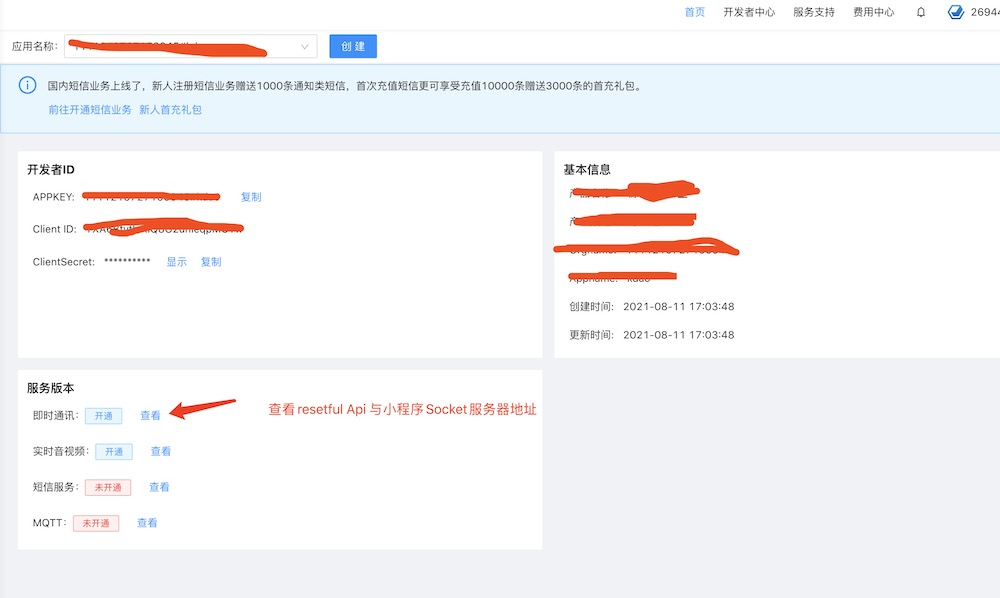

# TS 小程序打包说明

## 目录

- [代码配置替换](#一、代码配置替换)
- [图标资源替换](#二、图标资源替换)
- [打包上传](#三、打包上传)
- [上架注意事项](#四、上架注意事项)

-----

##### 一、代码配置替换

1. 替换小程序 `appid`

	位于 `package.json` 中的 `appid` 字段
	
2. 替换小程序中现在的本地小程序标题和名字

	位于 `package.json` 中的 `title`和`name` 字段，注意`name`不能使用中文

3. 替换服务器地址 

	位于 `package.json` 中的 `serverProdAPI` 字段
	
4. 替换聊天环信配置，位于 `package.json` 中

	- `chatkey` 字段，环信聊天`key`
	- `chatSocketServery` 字段，环信聊天中的小程序域名
	- `chatApiURL` 字段，环信聊天`REST API`

 
 
	

5. 需要AI客服的用户需手动

5. 替换订阅消息`key`

	
	地址：<https://mp.weixin.qq.com/>登录小程序， （功能>订阅消息>我的模板>对应的模板名称选用），项目中模板编号调整为自己的

	模板 1:名称（新订单通知），模板选用内容（下单用户、下单时间、订单编号、备注、收货地址）
	
	模板 2:名称（商家发货提醒），模板选用内容（商品名称、支付金额、物流信息、备注、发货时间）
	
	模板 3:名称（加圈成功提醒），模板选用内容（圈子名称、加入时间）
	
	模板 4:名称（加圈拒绝通知），模板选用内容（申请时间、申请圈子、申请人）

	替换位于 `package.json` 中的 `subscribNewOrder`、`subscribMerchantShipping`、`subscribCircleJoined`、`subscribCircleRefused`。
	
	备注： 服务器端也需要配置对应的模板编号

​		

##### 二、图标资源替换

小程序使用的素材以及icon通过服务端获取，通过管理后台“配置-小程序控制-小程序图片素材替换”，具体操作查看后台描述。		

	注意： 
	1、替换时确保图片的格式、名字、尺寸大小不要和原来的图片有差异
	2、非服务器配置版本升级更新需执行指令：php artisan wmc:init

##### 三、打包上传

1. 项目代码导入`Visual Studio Code`
2. Terminal 中执行 `npm install 或者 yarn install # 推荐方式 (速度快)`，进行依赖安装
3. 依赖安装完成后，Terminal 中执行 `npm start 或者 yarn start # 推荐方式 (速度快)`，进行编译，等待编译完成
4. 微信开发者工具，导入，选择项目所在路径，选择对应APPID，不是用云服务，确定，等待编译完成。
5. 功能确定无误后，选择上传，输入备注日志，上传
6. 微信管理后台 [链接](https://mp.weixin.qq.com/) 手动提交审核，审核通过后需手动发布

##### 四、上架注意事项

1.  小程序管理后台 [链接](https://mp.weixin.qq.com/) -设置-用户生成内容场景声明

 	- UGC场景 - 选择 - 用户资料、图片、文本、（如果有信息网络传播视听节目许可证可以选择视频）
 	- 内容安全机制 - 使用其他的内容审核产品
 	- 用户审核团队 - 有团队
 	- 审核机制说明  - 建议如下说明，可自行调整
 	
 				1. 文本内容我们有敏感词顾虑替换等测试，防止用户发布涉黄、暴力等不良信息，同事运营部门会进行内容抽查已防止遗漏的部分。
 				2. 图片、视频内容使用三方云平台进行涉黄、暴力等内容检测，以及运营部分的手动审核。

 
 	备注： 提交上架前，管理后台-运营-敏感词，增加一些当前的敏感热词。	

2. 上架开关说明

	提交审核的过程中，把管理后台的-配置-小程序控制 ， 关闭评论功能、视频功能、打赏功能。
	
	备注： 如果有ICP备案和公安部备案的情况下可以打开评论功能，如果有网络传播视听节目许可证可以打开视频功能

3. 小程序管理后台 [链接](https://mp.weixin.qq.com/)- 开发管理-服务器域名

	配置对应的服务器域名、聊天域名，如果有oss也许要配置对应的oss域名

​		
​		
​		
​		
​		
​		
​		
​		